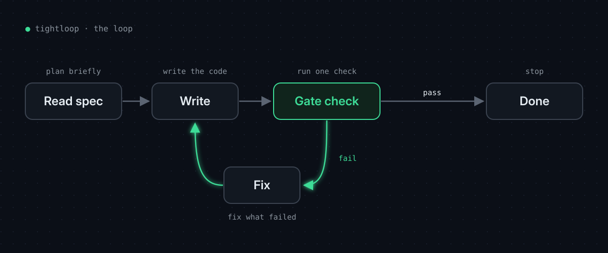
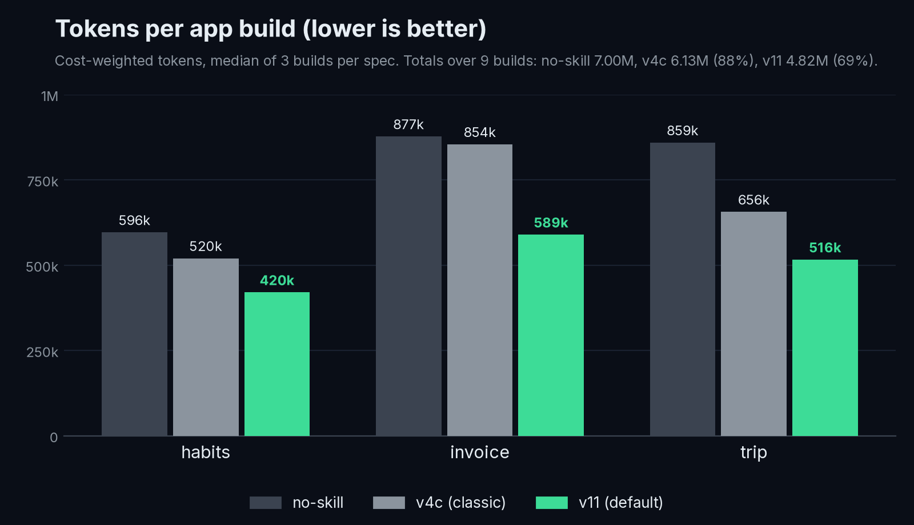
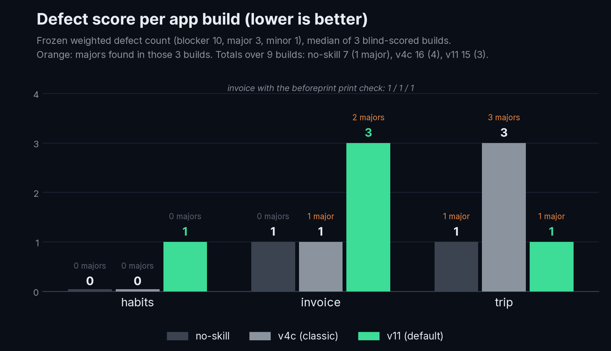

<p align="center">
  
</p>

# tightloop

tightloop is a small skill for coding agents. It is one short `SKILL.md` plus a gate
script that keeps the agent in a tight loop: look once, write once, run one check,
fix only what failed, stop. In our benchmark the 1.0 default built the same three
apps with **~8% fewer input+output tokens than an agent with no skill** (0-20% per app;
765k vs 703k summed over 9 builds) and at **~31% lower cost** (cost-weighted tokens,
summed over 9 builds); against the previous version (v4c) it was ~11% fewer
input+output tokens and ~21% lower cost. Most of the cost saving is cache reads,
because v11 makes far fewer model calls ([where the saving comes from](#where-the-saving-comes-from)).
Defect scores stayed near zero for every version, though not lower than no-skill.
[What's counted](#whats-counted) and the caveats are below.

**1.0 ships two versions:**

| | what it is | pick it when |
|---|---|---|
| **v11** (default) | `.claude/skills/tightloop/` and `AGENTS.md` at the repo root. 104 words, about 300 tokens. Has a bug-fix mode (proven by the gate) and an app mode (write each file once, syntax-check). | you want the lowest cost |
| **v4c** (classic) | [`classic/v4c/`](classic/v4c/), opt-in. A 3-call loop that always adds a test that fails without the change. | you want a test with every change |

## Install

Skill folders (agents that read `.claude/skills/`): copy the folder
`.claude/skills/tightloop/` (`SKILL.md` and `gate.sh`) into your project's
`.claude/skills/`.

```sh
git clone https://github.com/naman-sharma12345/tightloop
mkdir -p your-project/.claude/skills
cp -r tightloop/.claude/skills/tightloop your-project/.claude/skills/
chmod +x your-project/.claude/skills/tightloop/gate.sh
```

`AGENTS.md` (agents that read instructions from the project root): copy `AGENTS.md`
to your project's root **and** the same `.claude/skills/tightloop/` folder, because
`AGENTS.md` calls its `gate.sh` by that path.

Optional: `.claude/agents/scout.md` (read-only map of a large codebase) and
`.claude/agents/skeptic.md` (blind review of a finished diff). The core loop never
uses them; copy them to your project's `.claude/agents/` if you want them for big
or risky changes.

To use the classic v4c instead, see [`classic/v4c/README.md`](classic/v4c/README.md).

### Quick start

Nothing to run by hand. Once the folder is in place, give the agent a normal task
("fix the off-by-one in `parse_range`", "build the invoice app in `spec.md`"). For a
bug fix it ends by running:

```sh
bash .claude/skills/tightloop/gate.sh "<narrowest test command>" <changed files>
```

You can run the same line yourself. Its last line is the verdict: `GATE PASS (...)` or
`GATE FAIL: <reason>`.

## How the loop works

<p align="center">
  
</p>

([`loop.svg`](docs/assets/loop.svg) is the editable source.)

Every tool call re-sends the whole context, so the number of calls is the main
cost. v11 keeps it to one shell call per step and a 3-line reply:

1. **Read.** Search for the key symbols with `rg -n`, then print only the 20-40 lines
   that matter and the nearest test. No whole-file dumps.
2. **Write.** One heredoc per file, written once. For a bug fix: the root-cause fix and
   a test that fails without it (empty, boundary and error inputs checked first).
3. **Gate.** Bug fix: `gate.sh` runs the test with the change (must pass), then with
   the changed code put back to `HEAD` (must fail), fixes formatting, checks whitespace
   and lists possible debug leftovers. App: `node --check` on the JavaScript.
4. **Fix** only what the gate's last line names, rerun once, then **stop** and reply in
   3 lines: change, check, not checked.

## Results

Three single-page apps from fixed specs ([habits](benchmark/blind/specs/r11/habits.md),
[invoice](benchmark/blind/specs/r11/invoice.md), [trip](benchmark/blind/specs/r11/trip.md)),
built 3 times each per version on the same harness, same model and settings, one build
at a time: 27 builds, 0 retries, 0 voids.

**n=3 per cell. This is a small sample.**

### Tokens

<p align="center">
  
</p>

### What's counted

> [!NOTE]
> - **Token cost** is cost-weighted: `input + 5 × output + 0.1 × cache_read + 1.25 × cache_write`,
>   per build, from the agent CLI's own final usage report as the harness recorded it.
>   `input` is only the uncached input (tens of tokens per build); almost every prompt
>   token is billed as a cache read or a cache write.
> - **Totals** (765k / 789k / 703k input+output, 7.00M / 6.13M / 4.82M cost-weighted, and the
>   ~8%, ~31% and ~21%) are **sums over the 9 builds**
>   of each version. **Per-spec numbers are medians of 3 builds.** No means are used.
> - **Input+output alone** is a much smaller gap: v11 is ~8% below no-skill summed over
>   9 builds (703k vs 765k), 0-20% per app. Most of the cost saving is cache reads: the
>   median v11 build read 20.2k tokens from cache, the median no-skill build 1.81M
>   ([why](#where-the-saving-comes-from)).
> - **Skill size:** v11's `SKILL.md` is 104 words. In the build logs, the first model call of
>   every v11 build is 290-299 tokens longer than the no-skill build on the same spec
>   (v4c: 433-435), counted by the agent's own usage report. So "about 300 tokens".
>
> | spec (median of 3) | no-skill | v4c (classic) | v11 (default) |
> |---|---:|---:|---:|
> | habits: input+output | 60.4k | 65.8k | 60.2k |
> | habits: cost-weighted | 596k | 520k | 420k |
> | invoice: input+output | 102.5k | 110.3k | 87.2k |
> | invoice: cost-weighted | 877k | 854k | 589k |
> | trip: input+output | 92.9k | 90.5k | 73.9k |
> | trip: cost-weighted | 859k | 656k | 516k |
> | **sum of 9: input+output** | 765k | 789k | 703k |
> | **sum of 9: cost-weighted** | 7.00M | 6.13M | 4.82M |

Cost-weighted tokens, median of 3 builds:

| spec | no-skill | v4c (classic) | v11 (default) |
|---|---:|---:|---:|
| habits | 596k | 520k | **420k** (-30%) |
| invoice | 877k | 854k | **589k** (-33%) |
| trip | 859k | 656k | **516k** (-40%) |
| **sum, 9 builds** | 7.00M (100%) | 6.13M (88%) | **4.82M (69%)** |

On input+output tokens alone, v11 is 0.3% lower than no-skill on habits, 15% on invoice
and 20% on trip. On cost (the table above, percentages against no-skill) it is the lowest
on all 3 specs. Per-build
rows, min-max ranges and wall times:
[`results/appv2/compare/TABLE_r11_3arms.md`](results/appv2/compare/TABLE_r11_3arms.md).

### Where the saving comes from

Every model call re-reads the whole conversation so far, mostly from cache. A no-skill
build made a median of 22 model calls (over its 9 builds: 138 shell commands, 63 file
reads, 27 file writes); a v11 build made 2, because it writes every file in one shell
call and stops. The largest context in a build is similar (median 131k vs 107k tokens),
so the gap is the number of calls. **This comes from the skill, not the run setup.**

| per build, median of 9 | no-skill | v4c (classic) | v11 (default) |
|---|---:|---:|---:|
| model calls | 22 | 10 | 2 |
| cache read per call | 92k | 66k | 10k |
| cache read per build | 1.81M | 660k | 20.2k |
| largest context | 131k | 115k | 107k |
| first call warm (read the ~20k shared prefix) | 8 of 9 | 8 of 9 | 9 of 9 |

- **Same setup for every arm:** one harness, a fresh agent session per build (27
  sessions), one build at a time, the same model and settings, and the same spec order
  in each arm.
- **Warm vs cold cache is about 1% of the gap.** The first call of 25 of 27 builds read
  the same ~20k system prefix from cache, left warm by the build before; the two cold
  starts were the first build of the no-skill and v4c runs. That moves at most ~20k
  per build against a 1.8M gap. On v11's second call the cache had expired (its first
  call wrote the whole app and ran past the 5-minute cache lifetime), so v11 re-wrote
  its context rather than reading it. That costs v11, not helps it.
- **Cache reads are 84% of the cost saving:** summed over 9 builds, cache reads are
  1.84M of the 2.18M cost-weighted gap between no-skill and v11; output is 0.30M.
- **What the data can't rule out:** the arms ran in separate blocks of the same day
  (no-skill 08:17-10:35 UTC, v4c 14:32-16:40, v11 16:43-18:31), not interleaved. A
  rerun that alternates arms build by build on the same specs would settle that.

Per-call numbers come from the agent's stream log for each build (one usage record per
model call), the same log the token rows come from.

### Defects

<p align="center">
  
</p>

Weighted defect score (blocker 10, major 3, minor 1), median of 3 blind-scored builds.
Lower is better.

| spec | no-skill | v4c (classic) | v11 (default) |
|---|---:|---:|---:|
| habits | 0 | **0** | 1 |
| invoice (official print check) | 1 | **1** | 3 |
| invoice (with `beforeprint`) | 1 | 1 | 1 |
| trip | 1 | 3 | **1** |
| **total, 9 builds** | **7 (1 major)** | 16 (4 majors) | 15 (3 majors) |

What this says, honestly:

- **v11 is worse than v4c on habits and invoice and better on trip.** On habits each v11
  build has one minor defect (small tap targets, clipped labels). On invoice, two v11
  builds fail the official print check (a major each). On trip, v4c has 3 majors and v11 has 1.
- **The scale is near zero for every version** (medians 0 to 3), so on quality this is
  close to a tie. Neither skill beat no-skill on defects in this round.
- **The sideways-scroll major shows up in both skills** (one v11 build, two v4c
  builds), from one root cause: hidden screen-reader labels escape the trip board's
  clip. Because it is spread across versions we treat it as a harness or viewport
  artifact, not a skill effect.
- **The official print check does not fire `beforeprint`.** Apps that build their print
  view in a `beforeprint` handler print blank under it. Both numbers are given; the
  official one is the frozen check.
- **v11 writes no tests.** Builds with test files: v4c 6 of 9, v11 none, no-skill none.
  If you want a test with every change, use [v4c](classic/v4c/).
- Tokens here are app builds only. Bug-fix runs on the vendored task set are separate
  experiments under [`benchmark/`](benchmark/) and are not summarised here.

## Method

- **Blind labels.** Builds were renamed to random labels (B01, B02, ...) under a sealed key
  before scoring. The scorers never saw which version made which build; the key was
  opened only after the scores were committed.
- **Frozen checklist.** The defect checklist was written from the specs alone, before
  any build was opened, and frozen at commit `4c3b8e7`
  ([`CHECKLIST_r11.md`](benchmark/blind/defect_r11/CHECKLIST_r11.md), sha256
  `7495424dc0ab4f1df375a7802dddf1e1cc4c2e9aee2074b9adbc10d226865e99`). Scoring used real
  browser clicks through frozen scripts. One root cause counts once; defects not on the
  checklist are logged apart and are not in the score. Errata are logged, never edited
  into the checklist.
- **Weights.** Blocker 10, major 3, minor 1.
- **Files.**
  [protocol](benchmark/blind/defect_r11/PROTOCOL.md) ·
  [no-skill scores](benchmark/blind/defect_r11/SCORES_r11_ns.jsonl) ·
  [skill scores](benchmark/blind/defect_r11/arms/SCORES_r11_arms.jsonl) ·
  [print scores both ways](benchmark/blind/defect_r11/arms/PRINT_SCORES_r11_arms.jsonl) ·
  [first pass vs final rerun](benchmark/blind/defect_r11/arms/PASS_DIFF.md) ·
  [errata](benchmark/blind/defect_r11/arms/ERRATA_r11_arms.md) ·
  [harness v2](benchmark/blind/harness_v2/README_v2.md) ·
  [token rows](results/appv2/)
- The measured skill folders are kept byte for byte under
  [`benchmark/arms/`](benchmark/arms/) (`tightloop-v11`, `tightloop-v4c`, and every
  earlier version). The default at the repo root is a byte copy of `tightloop-v11`.

## Classic: v4c

v4c was tightloop's best version before 1.0 and stays available as an opt-in mode in
[`classic/v4c/`](classic/v4c/). It finishes a change in 3 tool calls and always adds a
test that fails without the change, proven by its gate. In the app benchmark v11 used
~11% fewer input+output tokens than v4c (703k vs 789k, summed over 9 builds) and cost
~21% less (cost-weighted tokens, 4.82M vs 6.13M), and v4c had lower defect medians
on habits and invoice. Install it in place of the default, not
beside it: [`classic/v4c/README.md`](classic/v4c/README.md).

## History

Every pre-1.0 working branch is kept as a tag `archive/<branch>` pointing at its last
commit. The list is in [`BRANCHES.md`](BRANCHES.md).

## License

MIT. See [`LICENSE`](LICENSE).
